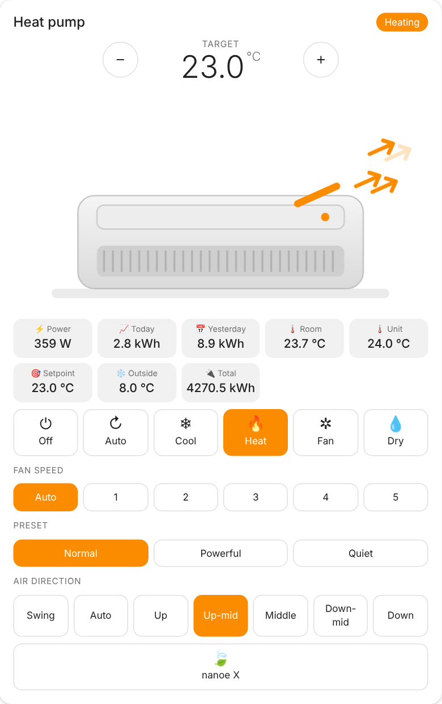
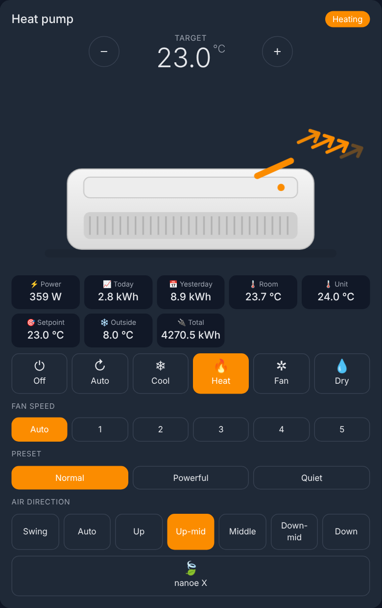
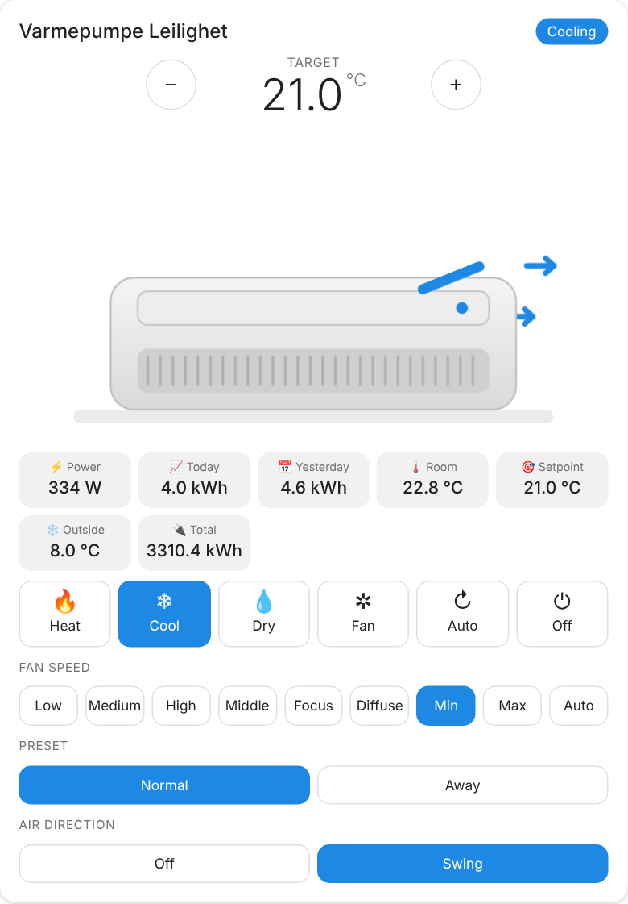

# Heatpump Card

Animated Lovelace card for **air-to-air heat pumps** and split air conditioners (works with any `climate` entity): target temperature on top, a unit picture in the middle with animated **air-flow arrows** that follow the fan speed and the air direction, clickable info tiles (power, energy today / yesterday / total, room, unit, setpoint, outside), mode buttons, fan speed, presets and air direction. Everything is configurable in the visual editor.

Made for a Panasonic floor unit (ESPthings climate interface) and a second split unit, but it only needs a standard `climate` entity. Languages: **Deutsch, Norsk, English**. Follows the Home Assistant light/dark theme.

## Preview

| Light | Dark | Cooling |
| --- | --- | --- |
|  |  |  |

Rendered in a test page with sample values; the icons are replaced there by simple symbols.

## Installation (HACS)

1. HACS → three dots → **Custom repositories** → add `https://github.com/mic-chr/heatpump-card`, category **Dashboard**.
2. Install **Heatpump Card**, reload the browser.
3. Dashboard → edit → **Add card** → **Heatpump Card**, or paste:

```yaml
type: custom:heatpump-card
entity: climate.my_heat_pump
room_entity: sensor.living_room_temperature
power_entity: sensor.heat_pump_power
energy_entity: sensor.heat_pump_energy_today
yesterday_entity: sensor.heat_pump_energy_yesterday
total_entity: sensor.heat_pump_energy_total
```

Manual install: copy `dist/heatpump-card.js` to `/config/www/` and add the resource `/local/heatpump-card.js` (JavaScript module).

## Options

Only `entity` is required. All other options can be set in the visual editor.

| Option | Default | Meaning |
| --- | --- | --- |
| `entity` | – | `climate` entity of the heat pump |
| `name` | friendly name | Title |
| `language` | HA language | `auto`, `de`, `no`, `en` |
| `room_entity` | – | Room temperature sensor (tile "Room") |
| `outdoor_entity` | – | Outdoor temperature sensor |
| `power_entity` | – | Power sensor (W) |
| `energy_entity` | – | Energy today (kWh or Wh) |
| `yesterday_entity` | – | Energy yesterday |
| `yesterday_attribute` | – | Use this attribute of `yesterday_entity`, e.g. `last_period` (utility meter) |
| `total_entity` | – | Energy total |
| `swing_entity` | – | `select` entity for the air direction (e.g. up / center / down). Without it the card offers the swing modes of the climate entity |
| `nanoe_entity` | – | Extra switch shown as button (nanoe X etc.) |
| `image` | drawn unit | Picture of your unit (URL or `/local/...`, transparent PNG works best) |
| `image_off` | – | Picture shown when the unit is off (e.g. closed flap) |
| `show_info`, `show_unit_temp`, `show_setpoint`, `show_modes`, `show_fan`, `show_preset`, `show_swing`, `show_arrows` | `true` | Show or hide sections |
| `color_heat`, `color_cool`, `color_dry`, `color_fan_only`, `color_auto` | orange / blue / yellow / grey / green | Mode colors |
| `color_arrow` | mode color | Arrow color |
| `image_front` | `[-0.93, 0.37]` | Direction the unit blows into, as screen vector when you use `image` (3D photo views) |

Tap any info tile to open the history of its entity.

### Own picture

Put a photo of your unit as transparent PNG into `/config/www/` and set `image: /local/my-unit.png`. The arrows start at the top edge of the picture; use `image_front` if your photo is shot from another angle. Please do not publish product photos you do not own the rights to.

## How the arrows work

- **Fan speed** (1–5, or Min…Max) sets number, size and speed of the arrows. Preset *Powerful* counts as 5, *Quiet* as 1.
- **Air direction** tilts the arrows up or down; *Swing* sweeps them.
- Arrows stop when the unit is off.

---

## Deutsch

Animierte Lovelace-Karte für **Luft-Luft-Wärmepumpen** und Split-Klimageräte (jede `climate`-Entität): Solltemperatur oben, das Gerät in der Mitte mit **Luftstrom-Pfeilen**, die sich nach Lüfterstufe und Luftrichtung richten, klickbare Infokacheln (Leistung, Energie heute/gestern/gesamt, Raum, Gerät, Soll, Außen), Modus, Lüfterstufe, Preset und Luftrichtung. Alles lässt sich im visuellen Editor einstellen.

**Installation:** HACS → Benutzerdefinierte Repositories → `https://github.com/mic-chr/heatpump-card` (Kategorie *Dashboard*) → installieren, Browser neu laden → Karte „Heatpump Card" hinzufügen. Optionen siehe Tabelle oben; ein Klick auf eine Kachel öffnet den Verlauf. Für ein eigenes Gerätebild: transparentes PNG nach `/config/www/` und `image: /local/mein-geraet.png` setzen.

## Norsk

Animert Lovelace-kort for **luft-luft-varmepumper** og split-klimaanlegg (alle `climate`-entiteter): ønsket temperatur øverst, enheten i midten med **luftstrøm-piler** som følger viftehastighet og luftretning, klikkbare infofliser (effekt, energi i dag/i går/totalt, rom, enhet, settpunkt, ute), modus, viftehastighet, forhåndsvalg og luftretning. Alt kan stilles inn i den visuelle editoren.

**Installasjon:** HACS → egendefinerte repositorier → `https://github.com/mic-chr/heatpump-card` (kategori *Dashboard*) → installer, last nettleseren på nytt → legg til kortet «Heatpump Card». Alternativer står i tabellen over. Trykk på en flis for å se historikken. Eget bilde av enheten: gjennomsiktig PNG i `/config/www/` og `image: /local/min-enhet.png`.

## License

MIT
